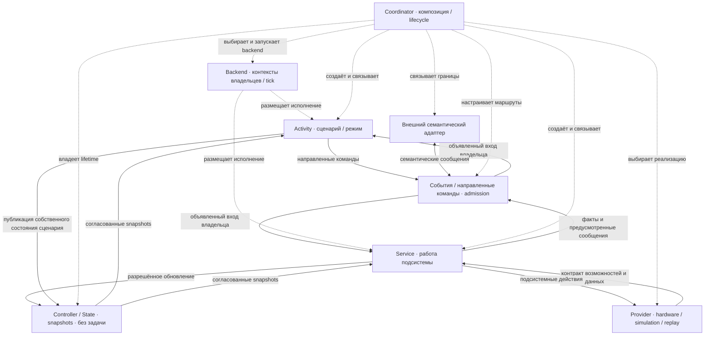

# Raven — архитектурная спецификация

## Назначение и обязательность

Raven — система поведения и взаимодействия подсистем. Эта спецификация определяет
её концептуальную модель, роли, границы зависимостей, контракты и обязательные
инварианты. Она служит основанием для проектирования и проверки реализации.
Временное сокращение кода, отсутствие конкретной подсистемы или успешный запуск
не меняют архитектурных требований.

Термины «должен», «обязан» и «запрещено» задают требования. Роль определяется
ответственностью и публичным контрактом, а не именем класса, наследованием,
каталогом, протоколом или RTOS-примитивом. Отсутствие экземпляра роли в конкретной
композиции не отменяет её определения.

Поведенческое ядро включает Activity, Service и State как архитектурные роли.
Исполнительная основа, адаптеры и платформенные providers обеспечивают их работу.
Границы этих понятий не определяются именами программных пакетов.

Любой слой и любой принцип могут быть пересмотрены обоснованным архитектурным
решением. Такое решение явно определяет проблему, альтернативы, изменяемый
контракт, последствия и способ проверки. До принятия изменения действует
существующее правило. Несоответствие кода является несоответствием реализации,
а не основанием молча ослабить спецификацию.

Проверка на компьютере, в симуляции и на реальном оборудовании подтверждает
проверенные свойства. Она не заменяет анализа архитектурного соответствия.
Описание конкретного backend, wire-протокола, конфигурации ресурсов и результаты
измерений ведутся отдельно от общих норм.

## Архитектурные аксиомы

### A01. Raven — платформенно независимая поведенческая система

ESP32/FreeRTOS является одним из возможных backend исполнения. Архитектура
сохраняет смысл вне ESP: те же роли и контракты действуют в симуляции и при
исполнении на компьютере. Наличие физического оборудования необязательно.
Платформенные детали находятся ниже поведенческого ядра.

### A02. Activity, Service и State принадлежат поведенческому ядру

Activity владеет оркестрацией и логикой режимов или сценариев. Service владеет
работой своей подсистемы. State представляет каноническое общее знание.
Эти роли не являются конструкциями ESP или FreeRTOS.

Платформенная зависимость внутри поведенческого слоя считается отклонением,
которое нужно явно обозначить и устранить либо рассмотреть отдельным
архитектурным решением. Само наличие зависимости в коде не делает её нормой.

### A03. Семантический смысл важнее транспортного происхождения сообщения

Вход может поступить через TCP, UART, RF, mock, симуляцию, синтетический источник
датчиков или локальную генерацию. Для поведения значимы смысл сообщения,
контракт payload, допустимость маршрута и принадлежность обработки владельцу.
Одинаковый семантический контракт не приобретает иной смысл из-за способа доставки.

Идентичность участника, корреляция и актуальность обращения могут входить в
объявленный семантический контракт. Их нельзя неявно подменять знанием сокета,
драйвера или типа транспорта.

### A04. Внешний транспорт является адаптерной границей

Wire-форматы, framing, внешние идентификаторы сообщений, кодеки и gateways:

- принимают внешнее представление;
- проверяют его корректность;
- переводят его в известный внутренний семантический контракт;
- доставляют его надлежащему владельцу через установленный admission.

Эта граница не является центром предметной семантики. Внешний пакет и внутреннее
сообщение имеют самостоятельные контракты; внутренние структуры памяти и локальные
адреса компонентов не становятся wire-протоколом автоматически.

### A05. Маршрутизация — строгая политика admission

Компонент может получить сообщение только при одновременном выполнении условий:

- сообщение известно;
- payload соответствует ожидаемому контракту;
- для внешнего представления существует явный decoder или адаптер;
- маршрут явно зарегистрирован или установлен контрактом адресного входа;
- получатель предназначен для этой обработки и объявил принимаемый контракт.

Уже сформированное внутреннее сообщение не требует wire-декодирования, но остаётся
подчинено тем же семантическим ограничениям и правилам admission. Нельзя доставлять
данные неподготовленному компоненту или обходить проверки через альтернативный API.

### A06. Архитектурные роли отделены от исполнительных механизмов

Activity определяется оркестрационной ответственностью, Service — исполнением
подсистемной работы. Задачи, очереди, tick, уведомления и scheduling принадлежат
исполнительной основе. Поведенческая модель не обязана оперировать понятиями
FreeRTOS. Общий интерфейс исполняемого компонента не объединяет разные роли
в одну ответственность.

### A07. Исполнительная основа размещает роли, а не определяет их

Исполнительная основа обеспечивает:

- асинхронное поступление работы;
- доставку и хранение входящих сообщений;
- периодическое обслуживание;
- корректное владение данными сообщений до конца обработки;
- разделение и управляемое исполнение контекстов владельцев.

Поведение Activity и Service выражается поверх этих механизмов. Последовательность
обработчиков и размещение владельца могут обеспечиваться разными backend.
Разделение контекстов не означает изоляцию адресных пространств.

### A08. Межконтекстная доставка безопасна по владению

В момент успешного admission сообщение должно стать самодостаточным для доставки.
Получатель не зависит от срока жизни исходного буфера производителя. Payload
остаётся действительным до завершения обработки.

Если данные находились во внешней памяти, простого копирования указателя
недостаточно: необходимые данные должны быть скопированы с определённым владением.
Заимствованный mutable-буфер не может пересекать очередь как обычный payload.
Это гарантия контракта доставки, а не побочный эффект текущего способа хранения.

### A09. Предметная логика исполняется только в контексте владельца

Решения Activity и работа Service выполняются в назначенном контексте компонента,
который ими владеет. Они не исполняются в event callback, транспортном ingress
или чужой задаче. Сообщения могут иметь много производителей; это не создаёт
несколько независимых контекстов исполнения одного владельца.

Admission и разрешённое чтение State не являются вызовом чужой предметной логики.
Ограниченная обработка платформенного ввода принадлежит адаптеру; она не даёт ему
права исполнять поведение Activity или Service.

### A10. State — единственный канонический источник общего знания

Если знание требуется более чем одному компоненту, оно представляется в State.
Activity и Service читают его через согласованный интерфейс и обновляют только
через разрешённые пути владения. Для одного общего факта не допускаются
несогласованные изменяемые источники истины.

Snapshot является наблюдением канонического состояния на определённый момент.
Локальная рабочая копия не становится самостоятельным авторитетным хранилищем.
Внутренние детали исполнения, не составляющие общее знание, остаются у владельца.

### A11. Activity оркестрирует, Service исполняет

- Activity определяет, что требуется сценарию или режиму системы.
- Service выполняет работу своей подсистемы.
- State хранит каноническое знание.
- Адаптеры соединяют поведенческую модель с внешним миром.

Activity не выполняет низкоуровневую подсистемную работу напрямую.
Service не присваивает общесистемные решения оркестрации. Внутренняя FSM сервиса,
включая подготовку, исполнение, восстановление и завершение его операций,
остаётся частью подсистемной ответственности.

### A12. Tick — полноценный вход поведения

Message-driven и time-driven поведение являются равноправными частями модели.
Владелец может на периодическом шаге читать статусы, продвигать операцию,
проверять свои deadlines и пересматривать принадлежащую ему политику.
Activity может менять решение сценария на своём tick, сохраняя взаимодействие
с независимо работающими сервисами.

Tick поддерживает policy loops, supervision, автономное и sensor-driven поведение.
Он не сводится к watchdog или единственному способу получения состояния устройства.

### A13. Физическое оборудование — один из возможных providers

Нижние слои могут предоставлять физические датчики, симулированные датчики,
mock-устройства, синтетические управляющие потоки и воспроизведение записанных
данных. Поведенческий контракт сохраняется при замене provider.
Знание о физической или синтетической реализации находится в нижнем слое,
а не в условных ветвлениях предметной логики.

### A14. Конкретные подсистемы проверяют архитектуру, а не определяют её

Продуктовый или экспериментальный срез должен позволять проверять отзывчивость,
поведение под нагрузкой, маршрутизацию, границы владения и взаимодействие
оркестрации с исполнением. Его предметная область не становится границей Raven.

Срез можно удалить после выполнения его задачи. Отсутствие конкретной Activity,
Service, State или provider не отменяет роль и её контракт. Переиспользуемые
архитектурные возможности сохраняют смысл независимо от текущего потребителя;
обоснование отдельного класса рассматривается отдельно от существования роли.
Архитектурные выводы продолжают проверяться в других сценариях и на реальном
оборудовании.

Аксиомы определяют интерпретацию системы. Ролевые определения и инварианты ниже
конкретизируют их; текущая композиция должна оцениваться относительно этих норм.

## Архитектурные роли

### Activity

Activity — высокоуровневый владелец оркестрации, сценария или режима и переходов
между его состояниями. Режимы boot, idle, manual, autonomous, recovery и fault
являются допустимыми примерами; роль не ограничена машиной или глобальным режимом.
FSM — возможный способ выражения её логики.

Ответственности:

- **ACT-01.** Получать предназначенные ей системные события и реагировать на
  изменения канонического State.
- **ACT-02.** Определять, какие возможности и режимы работы сервисов нужны сценарию.
- **ACT-03.** Передавать направленные команды сервисам, когда сценарий или переход
  режима требует действия; соблюдать их admission- и исполнительные контракты.
- **ACT-04.** Читать согласованные snapshots State для оркестрационных решений.
- **ACT-05.** Исполнять решения последовательно в своём назначенном owner context,
  используя объявленный вход сообщений и периодическое обслуживание.

Ограничения:

- **ACT-06.** Не обращаться напрямую к аппаратным драйверам и peripheral API.
- **ACT-07.** Не изменять общее состояние в обход Controller/State API и не
  присваивать право записи чужого State. Состояние собственного сценария
  публикуется через предназначенный для него state-контракт.
- **ACT-08.** Не выполнять блокирующий внешний I/O; соответствующая работа
  запрашивается у исполнителя через его контракт.
- **ACT-09.** Не выполнять оркестрационную логику в платформенном event callback.
- **ACT-10.** Не угадывать сроки исполнения чужой подсистемы и не объявлять исход
  чужой операции вместо её владельца. Activity наблюдает предусмотренный
  сервисным контрактом статус и решает, как продолжать свой сценарий.

### Service

Service — асинхронный владелец работы связной аппаратной подсистемы или
программного стека. Он инкапсулирует способ выполнения работы: взаимодействие
с provider, внутреннюю последовательность действий, ограничения, прогресс
и предусмотренные исходы. Работа может быть реактивной, конечной или непрерывной.

Ответственности:

- **SVC-01.** Обслуживать подсистему в своём owner context на протяжении её
  lifecycle, реагируя на сообщения, callbacks через вход владельца и tick.
  Ожидание входа не нарушает непрерывную готовность сервиса к работе.
- **SVC-02.** Получать данные от hardware/providers/внешних стеков через
  соответствующие контракты и публиковать общее знание через State.
- **SVC-03.** Публиковать предусмотренные контрактом события о значимых фактах
  и переходах всем зарегистрированным для этих событий потребителям через
  механизм событийной доставки.
- **SVC-04.** Принимать и исполнять направленные команды из своего входа,
  различая admission, предметное принятие задания и итог исполнения.
- **SVC-05.** Владеть сроками и результатами своих операций. Для принятого
  конечного задания обеспечивать предусмотренный контрактом итог, включая
  неуспех, отмену, вытеснение или истечение собственного deadline.
  Для продолжающегося управления определять условия обновления цели и завершения.

Ограничения:

- **SVC-06.** Не принимать общесистемные решения режима или сценария, принадлежащие
  Activity. Внутренние подсистемные решения остаются у Service.
- **SVC-07.** Не обращаться к внутренностям другого Service и не исполнять его
  обработчики напрямую. Межкомпонентное взаимодействие использует объявленные
  командные, событийные и state-контракты.
- **SVC-08.** Не хранить общее изменяемое знание как разрозненные детали собственной
  реализации, доступ к которым требует зависимости от поведения Service.
  Для такого знания предназначен самостоятельный контракт Controller/State.
- **SVC-09.** Не переносить свою ответственность за операцию на наблюдателя,
  транспортный ingress или оркестратор.

### Controller / Shared State

Controller/State — thread-safe каноническое хранилище общего знания.
Для факта, такого как уровень батареи, состояние Wi-Fi или последняя известная
позиция, определены одно авторитетное представление и область его актуальности.
Независимые mutable-поля разных сервисов не могут конкурировать за эту роль.

Ответственности:

- **STATE-01.** Предоставлять контролируемый, thread-safe write API разрешённым
  владельцам данных. Владение записью и границы согласованности объявляются явно.
- **STATE-02.** Предоставлять thread-safe snapshot/read API Activity, Service
  и другим разрешённым потребителям.
- **STATE-03.** Защищать внутренние данные необходимой синхронизацией:
  mutex, atomics либо эквивалентным механизмом, соответствующим модели доступа.
- **STATE-04.** Иметь самостоятельный контракт хранения, чтения и обновления,
  отделённый от поведения Service/Activity. Владение объектом State по lifetime
  не разрешает потребителям обращаться к внутренностям поведенческого владельца.

Ограничения:

- **STATE-05.** Не содержать предметную логику выбора целей, действий подсистемы
  или сценарных реакций. Проверка целостности данных и соблюдение объявленных
  правил хранения относятся к ответственности хранилища.
- **STATE-06.** Не публиковать события, не отправлять команды и не вызывать
  поведенческие обработчики. Решение об уведомлении принимает владелец поведения.
- **STATE-07.** Не иметь собственной задачи или автономного цикла поведения.
- **STATE-08.** Не выдавать произвольные изменяемые ссылки на внутреннее хранилище
  в обход write API и правил синхронизации.

### Coordinator / корень композиции

Coordinator — корень построения и bootstrap одного экземпляра Raven.
Он владеет графом объектов и местом определения межкомпонентных связей.
Создание внутренних частей может быть делегировано составному компоненту,
но lifetime и связи остаются определёнными композицией.

Ответственности:

- **ROOT-01.** Обеспечивать необходимую инициализацию платформы, включая системный
  event loop там, где backend в нём нуждается; платформенные детали делегируются
  соответствующему слою.
- **ROOT-02.** Создавать канонические State-хранилища и определять их lifetime.
- **ROOT-03.** Создавать Service, явно передавая необходимые State и provider-контракты.
- **ROOT-04.** Создавать Activity и внедрять необходимые сервисные и state-контракты.
- **ROOT-05.** Обеспечивать регистрацию подписок, адресных входов и маршрутов
  до их конкурентного использования. Компонент может объявлять входной контракт
  при построении; соединение компонентов определяется композицией.
- **ROOT-06.** Запускать владельцев и адаптеры в порядке, обеспечивающем корректные
  зависимости, lifetime и admission.
- **ROOT-07.** Предоставлять graceful shutdown runtime: прекращение нового входа,
  согласованное завершение владельцев по их контрактам и освобождение ресурсов
  после окончания их использования. Закрытие одного соединения не заменяет
  завершение всей композиции.

Ограничения:

- **ROOT-08.** Не содержать оперативную предметную логику и не принимать решения
  сценариев; он связывает и запускает владельцев этой логики.
- **ROOT-09.** Не допускать независимого повторного построения или запуска того же
  экземпляра runtime из разных мест. У экземпляра один корень композиции;
  entry point определяется backend, например app_main на ESP.

### Событийная доставка / Event Bus / Dispatcher

Это роль связи между владельцами, отделяющая производителей сообщений от
исполнения потребителей. Event Bus описывает событийную публикацию и подписки;
Dispatcher — выбор адресатов и admission. Они могут использовать общую основу,
но адресная отправка сама по себе не устанавливает полный контракт broadcast.
Привязка к SDK event loop не входит в определение этой роли.

Ответственности:

- **DEL-01.** Доставлять типизированное событие всем зарегистрированным для него
  подписчикам с явным результатом admission каждого адресата. Ни один подписчик
  не может быть молча исключён из предназначенного ему fan-out.
- **DEL-02.** Переносить направленную команду к установленному владельцу.
  Доставка может проходить через диспетчер либо заранее связанный адресный
  вход очереди, если тот является частью объявленного маршрута и сохраняет
  все проверки и политики admission. Произвольный доступ к чужому Inbox
  не является разрешением обойти установленный контракт.
- **DEL-03.** Развязывать поведение производителей и потребителей через
  контракты сообщений и настройку маршрутов. Добавление потребителя меняет
  композицию/подписки, не требует знания его реализации производителем.
- **DEL-04.** Не выполнять обработчики получателей при admission.
  Для fan-out результат отражается по адресатам; частичный отказ не откатывает
  уже состоявшийся приём и не маскируется общим успехом.

Ограничения:

- **DEL-05.** Не использовать сообщения для совместного владения большими mutable
  структурами. Общее изменяемое знание читается через State; payload доставки
  подчинён A08.
- **DEL-06.** Не исполнять business logic в event callback. Callback выполняет
  ограниченное сохранение входа и доставку владельцу, затем возвращается.
- **DEL-07.** Не выводить право на получение сообщения из одной доступности
  объекта или совпадения размера payload: действует полный семантический
  и маршрутный контракт A05.

### Внешние адаптеры

Адаптер владеет переводом представлений и техническим состоянием внешней границы.
Он зависит от внешнего протокола, объявленных семантических контрактов,
маршрутизации и необходимых платформенных интерфейсов.
Он не получает права управлять внутренним поведением Service/Activity.

- **ADP-01.** Собирать, проверять и декодировать вход; переводить его в известное
  сообщение и выполнять установленный admission без ожидания предметного исполнения.
- **ADP-02.** Принимать исходящие семантические сообщения через объявленный вход,
  кодировать и передавать их внешнему участнику. Исходящий адаптер не выбирает
  предметные цели, повторы операции или её итог.
- **ADP-03.** Изолировать wire layout, framing, транспортные ресурсы и их lifetime
  от поведенческой модели. Чтение State для внешнего представления подчиняется
  тому же snapshot-контракту, что и чтение другими потребителями.

### Исполнительный backend и providers

Backend размещает владельцев, обеспечивает периодическое обслуживание и
ожидание входа. Providers реализуют аппаратные или синтетические зависимости.
Их интерфейсы определяются требуемыми возможностями, а реализации могут
использовать SDK, RTOS, драйверы и системные ресурсы.

- **PLAT-01.** Обеспечивать назначенный owner context, последовательность обработчиков,
  безопасную доставку и объявленные временные свойства.
- **PLAT-02.** Владеть техническими ресурсами платформы и их lifecycle; не переносить
  SDK-типы и правила управления ресурсом в предметную логику.
- **PLAT-03.** Сохранять provider-контракт при использовании hardware, mock,
  simulation, synthetic input или replay.
- **PLAT-04.** Сохранять callbacks ограниченными по работе; платформенная обработка
  не должна превращаться в исполнение поведения чужого владельца.

## Границы зависимостей и владения

| Роль | Разрешённые зависимости по ответственности | Запрещённая связанность |
|---|---|---|
| Activity | Сервисные командные контракты, State snapshots, события, исполнительные входы и время | Драйверы, сокеты, внутренности Service, запись чужого State |
| Service | Provider-контракты своей подсистемы, разрешённый State API, сообщения и доставка, время | Внутренности другого Service, прямое исполнение чужих handlers, присвоение общесистемной оркестрации |
| State | Типы данных, правила хранения и средства синхронизации | Поведенческие обработчики, отправка команд/событий, собственный исполнитель |
| Доставка | Контракты сообщений, подписки, маршруты, входы получателей | Предметные решения получателя и выполнение их при admission |
| Адаптер | Внешний протокол, семантические контракты, доставка, разрешённые snapshots, платформенные интерфейсы | Обход владельца поведения или подмена его State |
| Backend/provider | Контракты размещения/возможностей, SDK и технические ресурсы | Определение предметной политики Activity/Service |
| Корень композиции | Конструируемые объекты, конфигурация, lifecycle и соединение контрактов | Оперативное поведение системы |

Владение поведением, право обновлять State, владение объектом по lifetime
и владение контекстом исполнения — разные отношения и должны быть определены
отдельно. Инъекция ссылки не передаёт автоматически чужую ответственность.

Публичный фасад команды может выражать семантический API и выполнить admission.
Он не должен синхронно запускать чужую предметную обработку, обходить маршрут
или раскрывать изменяемые внутренности владельца. Межсервисное взаимодействие
оценивается по этим контрактам, а не только по видимости метода в языке.
Чтение общего знания зависит от State API, не от реализации поведения сервиса.

## Семантика взаимодействия

### Факты, намерения и состояние

Событие сообщает установленный факт. Команда выражает направленное намерение
получить действие от владельца. Запрос чтения получает знание через разрешённый
контракт. Направленность или broadcast не заменяют это семантическое различие.

Событие может побудить потребителя прочитать State, но само не становится вторым
mutable-источником истины. Журнал сохраняет диагностические записи; он не заменяет
канонический State или обязательную доставку события поведенческим подписчикам.

### Доставка, admission и исполнение

Попытка локального admission имеет непосредственный результат: вход принял
принадлежащие доставке данные либо отказал с определённой причиной. Она не ждёт
вызова предметного обработчика и не утверждает, что работа началась или завершена.

Протокольный ACK/NACK описывает именно согласованную стадию admission.
Он не является результатом физического действия и не совпадает с подтверждением
пакета нижележащим транспортом. Семантический результат операции принадлежит
исполнителю и наблюдается через State или иной предусмотренный им контракт ответа.
Отдельный push результата и ACK получения результата не обязательны для всех операций.

Владелец определяет срок конечной операции и гарантируемый исход своего API.
Activity доверяет этому контракту, наблюдает результат и выбирает дальнейший
сценарий. Потеря связи с наблюдателем не означает автоматически неуспех или отмену
уже принятой подсистемной работы.

### Сообщения, callbacks и время

Обработчики поведения одного владельца исполняются последовательно.
Синхронизированное чтение State другими контекстами не даёт им право вызывать
поведенческие обработчики. Callback сохраняет необходимые данные до истечения
их внешнего lifetime и передаёт вход владельцу.

Поток сообщений не должен бесконечно вытеснять предусмотренное контрактом
периодическое обслуживание. Контракт backend определяет scheduling, обработку
пропущенных периодов и способ ожидания. Контракт владельца определяет допустимую
работу обработчика и реакцию на deadlines, новые цели и критические сообщения.
Длительность физического процесса не равна длительности вызова обработчика.

### Очерёдность, актуальная цель и критичность

Политика доставки определяется известным локальным контрактом:

- Ordered сохраняет последовательность отдельных принятых сообщений;
- Latest допускает замену необработанного значения более актуальным только там,
  где это разрешено семантикой;
- Critical имеет safety-critical смысл и предусмотренный приоритет admission
  и обслуживания. Если контракт допускает coalescing, замена сохраняет его гарантии.

ACK/NACK, обычная диагностика и желание ускорить ответ не делают сообщение Critical.
Внешний отправитель не назначает произвольный приоритет в обход локальной политики.
Критическое сообщение не определяет универсальную предметную реакцию:
что остановить, отменить или продолжить, решает соответствующий владелец.
Общий latch, Reset или reboot не следуют автоматически из факта критичности.

Новая цель, отмена, вытеснение и несовместимые запросы имеют правила в контракте
сервиса. Очередь или оркестратор не угадывают эти правила по времени прихода.

## Межустройственная коммуникация

Коммуникация расширяет взаимодействие Raven через границы устройств, сохраняя
роли, State и локальное владение поведением. Она не устанавливает отдельную
поведенческую модель для сетевых запросов.

- **COM-01.** Каждый экземпляр Raven имеет локальные входы и маршрутизацию.
  Удалённое устройство не получает прямой доступ к Inbox, памяти или обработчику
  другого экземпляра. Общий wire-язык описывает устройства и семантические
  контракты, не сериализует внутреннее устройство runtime.
- **COM-02.** Ingress завершает сборку, валидацию, перевод и admission; затем
  продолжает принимать вход. Он не ждёт предметного исполнения. Требуемое
  подтверждение admission проходит через установленный исходящий контракт.
- **COM-03.** Egress принимает сообщения от локальных производителей, кодирует
  и передаёт их. Владение записью в поток исключает перемешивание кадров;
  выбор задач и механизм сериализации относятся к backend.
- **COM-04.** Ресурс соединения имеет определённого владельца lifecycle.
  Закрытие, незавершённый ввод/вывод и повторное использование ресурса
  обрабатываются согласованно с ingress, egress и владельцами поведения.
- **COM-05.** Устройство, экземпляр его запуска, корреляция запроса и локальная
  ссылка на соединение имеют разные значения. Сообщение, ответ или отложенное
  завершение предыдущей сессии не может обновлять актуальный State или попадать
  в новое соединение как действующее. Проверка актуальности защищает сам commit,
  а не только отправку ответа.
- **COM-06.** Локальный admission, завершение локальной отправки, удалённый
  admission и семантический результат — разные стадии. Для каждого deadline
  определены начало отсчёта, владелец, условия завершения и влияние повторов.
  Timeout не выдаётся за полученный NACK и не доказывает неуспех удалённой операции.
- **COM-07.** Семантические повторы, идемпотентность, обработка дубликатов,
  готовность и keepalive принадлежат соответствующим сервисным контрактам.
  Они не становятся скрытым поведением общего ingress или byte transport.
- **COM-08.** State удалённого участника представлен как локально известное
  наблюдение с необходимой идентичностью и актуальностью. Связность соединения,
  готовность устройства и исход предметной операции не являются одним фактом.
  Часы разных устройств не считаются синхронизированными без отдельного контракта.
- **COM-09.** Ёмкость, admission при перегрузке, судьба pending-данных при закрытии
  и восстановлении, повторы и наблюдаемость потерь определяются явно.
  Принятая работа не объявляется отменённой только из-за потери её подтверждения.
- **COM-10.** Число устройств, транспортных задач и буферов задаётся ресурсным
  профилем и возможностями backend. Оно не определяет число архитектурных ролей
  и не требует нового поведения для каждого физического устройства.
  Изменение профиля требует проверки ресурсов и временных гарантий.

## Архитектурные инварианты

Эти правила обязательны для реализации. Их изменение подчиняется порядку
архитектурных решений, определённому в начале спецификации.

1. **INV-01 — единый State.** Общее знание имеет каноническое хранилище и
   контролируемые пути записи. Snapshots не становятся конкурирующими mutable
   источниками истины.
2. **INV-02 — факт и намерение различаются.** Событие сообщает факт, команда
   направляет намерение владельцу; вид доставки не подменяет эту семантику.
3. **INV-03 — оркестрация отделена от исполнения.** Activity не управляет
   hardware напрямую; Service не присваивает общесистемные решения режима.
4. **INV-04 — callbacks остаются тонкими.** Callback исполняется в контексте
   источника; предметная работа переносится во вход и контекст владельца.
5. **INV-05 — поведение исполняется владельцем.** Контекст и сериализация
   обработчиков определены явно. Это исключает произвольное исполнение на
   чужом стеке и неожиданную реентерабельность через доставку.
   Достаточность стеков, приоритеты и свойства блокировок проверяются отдельно.
6. **INV-06 — задача не требуется каждому классу.** Отдельный исполнитель
   обосновывается необходимостью независимой работы, ожидания I/O, периодической
   выборки или обслуживания входа. Учитываются стоимость памяти и scheduling;
   State собственной задачи не имеет.
7. **INV-07 — явная основа предпочтительнее преждевременного framework.**
   Зависимости и wiring задаются явно. Универсальные DI containers, динамические
   реестры и locators сервисов, тяжёлые template-механизмы не вводятся без
   конкретной потребности и оценки более простого решения.

## Связи между ролями

Стрелки доставки означают admission во вход владельца, а не синхронный вызов
его предметного обработчика. Потребители событий определяются подписками.
State остаётся thread-safe источником истины без собственной задачи и без
публикации событий. Все связи и lifetime определяются корнем композиции.

Технические материалы: [коммуникационная реализация](communication-architecture.md),
[wire-контракт и временные правила обмена](communication.md).
Они описывают конкретные механизмы и не переопределяют требования этой спецификации.
