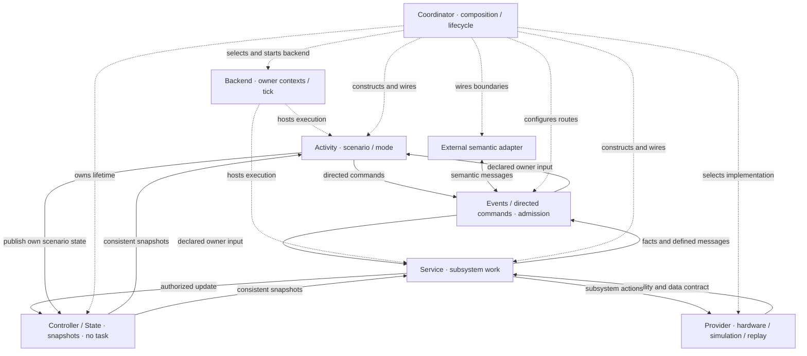

# Raven — Architectural Specification

## Purpose and authority

Raven is a system for behavior and subsystem interaction. This specification defines
its conceptual model, roles, dependency boundaries, contracts, and mandatory
invariants. It provides the basis for designing and reviewing implementations.
Temporary implementation shortcuts, the absence of a particular subsystem, or a
successful run do not change architectural requirements.

The terms "must", "shall", and "must not" express requirements. A role is defined
by responsibility and public contract, not by a class name, inheritance,
directory, protocol, or RTOS primitive. The absence of a role instance in a
particular composition does not invalidate its definition.

The behavioral core includes Activity, Service, and State as architectural roles.
The execution substrate, adapters, and platform providers support their operation.
The boundaries of these concepts are not defined by software package names.

Any layer or principle may be revised through a justified architectural decision.
That decision explicitly identifies the problem, alternatives, the contract being
changed, consequences, and verification approach. The existing rule applies until
the change is accepted. A code deviation is an implementation deviation, not a
reason to silently weaken the specification.

Host, simulation, and hardware tests confirm the properties they exercise.
They do not replace architectural compliance analysis. Descriptions of specific
backends, wire protocols, resource configurations, and measured results are
maintained separately from general requirements.

## Architectural axioms

### A01. Raven is a platform-independent behavioral system

ESP32/FreeRTOS is one possible execution backend. The architecture retains its
meaning outside ESP: the same roles and contracts apply in simulation and on a
host computer. Physical hardware is optional. Platform details belong below the
behavioral core.

### A02. Activity, Service, and State belong to the behavioral core

Activity owns orchestration and mode or scenario logic. Service owns its
subsystem's work. State represents canonical shared knowledge.
These roles are not ESP or FreeRTOS constructs.

A platform dependency inside the behavioral layer is a deviation that must be
explicitly identified and removed or considered through a separate architectural
decision. The presence of a dependency in code does not make it a requirement.

### A03. Semantic meaning takes precedence over transport origin

Input may arrive through TCP, UART, RF, a mock, simulation, a synthetic sensor
source, or local generation. Behavior depends on message meaning, the payload
contract, route legitimacy, and handling ownership. The same semantic contract
does not acquire a different meaning because of its delivery path.

Participant identity, correlation, and request validity may be part of a declared
semantic contract. They must not be implicitly replaced with knowledge of a
socket, driver, or transport type.

### A04. External transport is an adapter boundary

Wire formats, framing, external message identifiers, codecs, and gateways:

- accept an external representation;
- validate it;
- translate it into a known internal semantic contract;
- deliver it to the appropriate owner through the established admission contract.

This boundary is not the center of domain semantics. An external packet and an
internal message have independent contracts; internal memory layouts and local
component addresses do not automatically become the wire protocol.

### A05. Routing is strict admission policy

A component may receive a message only when all of the following hold:

- the message is known;
- its payload matches the expected contract;
- an explicit decoder or adapter exists for an external representation;
- the route is explicitly registered or established by an addressed input contract;
- the recipient is intended to handle it and has declared the accepted contract.

An already formed internal message does not require wire decoding, but remains
subject to the same semantic constraints and admission rules. Data must not reach
an unprepared component or bypass validation through an alternative API.

### A06. Architectural roles are separate from execution mechanisms

Activity is defined by orchestration responsibility; Service is defined by
subsystem execution. Tasks, queues, ticks, notifications, and scheduling belong
to the execution substrate. The behavioral model need not operate in FreeRTOS
terms. A common executable-component interface does not merge distinct roles
into a single responsibility.

### A07. The execution substrate hosts roles rather than defining them

The execution substrate provides:

- asynchronous arrival of work;
- delivery and storage of incoming messages;
- periodic servicing;
- valid ownership of message data through the end of handling;
- separation and controlled execution of owner contexts.

Activity and Service behavior is expressed above these mechanisms. Different
backends may provide handler sequencing and owner placement.
Context separation does not imply address-space isolation.

### A08. Delivery across contexts is ownership-safe

At successful admission, a message must become self-contained for delivery.
The recipient does not depend on the lifetime of the producer's original buffer.
The payload remains valid until handling completes.

When data resides in external memory, copying a pointer is insufficient: the
required data must be copied with defined ownership. A borrowed mutable buffer
must not cross a queue as an ordinary payload. This is a delivery-contract
guarantee, not an incidental property of the current storage mechanism.

### A09. Business logic executes only in owner context

Activity decisions and Service work execute in the assigned context of the
component that owns them. They do not execute in an event callback, transport
ingress, or a foreign task. Messages may have many producers; that does not
create multiple independent execution contexts for one owner.

Admission and permitted State reads are not calls to another owner's business
logic. Bounded platform-input processing belongs to an adapter; it does not
authorize the adapter to execute Activity or Service behavior.

### A10. State is the single canonical source of shared knowledge

Knowledge required by more than one component is represented in State.
Activities and Services read it through an agreed interface and update it only
through authorized ownership paths. A shared fact must not have inconsistent,
mutable sources of truth.

A snapshot is an observation of canonical state at a particular moment.
A local working copy does not become an independent authoritative store.
Internal execution details that are not shared knowledge remain with their owner.

### A11. Activities orchestrate; Services perform

- Activity determines what a scenario or system mode requires.
- Service performs its subsystem's work.
- State stores canonical knowledge.
- Adapters connect the behavioral model to the outside world.

Activity does not perform low-level subsystem work directly.
Service does not take ownership of system-wide orchestration decisions. A service's
internal FSM, including preparation, execution, recovery, and completion of its
operations, remains part of its subsystem responsibility.

### A12. Tick-driven behavior is a first-class part of the model

Message-driven and time-driven behavior are equally valid parts of the model.
During a periodic step, an owner may read status, advance an operation, check its
deadlines, and revise the policy it owns. An Activity may revise a scenario decision
on its own tick while interacting with independently operating services.

Ticks support policy loops, supervision, autonomy, and sensor-driven behavior.
They are not limited to a watchdog or the sole means of obtaining device state.

### A13. Physical hardware is one possible provider

Lower layers may provide physical sensors, simulated sensors, mock devices,
synthetic control streams, and replayed data. The behavioral contract remains
valid when the provider is replaced. Knowledge of whether an implementation is
physical or synthetic belongs to the lower layer, not to conditionals in business
logic.

### A14. Concrete subsystems exercise the architecture; they do not define it

A product or experimental slice must enable verification of responsiveness,
behavior under load, routing, ownership boundaries, and the interaction between
orchestration and execution. Its domain does not become the boundary of Raven.

A slice may be removed after it has served its purpose. The absence of a concrete
Activity, Service, State, or provider does not invalidate the role or its contract.
Reusable architectural capabilities remain meaningful without a current consumer;
the justification for a particular class is separate from the existence of a role.
Architectural conclusions continue to be tested in other scenarios and on real
hardware.

The axioms determine how the system is interpreted. The role definitions and
invariants below make them concrete; the current composition must be assessed
against these requirements.

## Architectural roles

### Activity

Activity is the high-level owner of orchestration, a scenario or mode, and
transitions between its states. Boot, idle, manual, autonomous, recovery, and fault
are valid examples; the role is not restricted to a vehicle or a global mode.
An FSM is one possible way to express its logic.

Responsibilities:

- **ACT-01.** Receive the system events intended for it and react to changes in
  canonical State.
- **ACT-02.** Determine which service capabilities and operating modes a scenario needs.
- **ACT-03.** Send directed commands to services when a scenario or mode transition
  requires action, respecting their admission and execution contracts.
- **ACT-04.** Read consistent State snapshots for orchestration decisions.
- **ACT-05.** Execute decisions sequentially in its assigned owner context,
  using a declared message input and periodic servicing.

Constraints:

- **ACT-06.** Do not access hardware drivers or peripheral APIs directly.
- **ACT-07.** Do not modify shared state outside the Controller/State API or assume
  write ownership of another owner's State. Publish the scenario's own state
  through its designated state contract.
- **ACT-08.** Do not perform blocking external I/O; request that work from an
  executor through its contract.
- **ACT-09.** Do not execute orchestration logic in a platform event callback.
- **ACT-10.** Do not guess another subsystem's execution deadlines or declare an
  operation's outcome on behalf of its owner. Observe the status provided by
  the service contract and decide how to continue the scenario.

### Service

Service is the asynchronous owner of work for a coherent hardware subsystem or
software stack. It encapsulates how work is performed: provider interaction,
internal sequencing, constraints, progress, and defined outcomes.
Work may be reactive, finite, or continuous.

Responsibilities:

- **SVC-01.** Service the subsystem in its owner context throughout its lifecycle,
  reacting to messages, callbacks delivered through the owner's input, and ticks.
  Waiting for input does not violate the service's continuous readiness to work.
- **SVC-02.** Obtain data from hardware, providers, or external stacks through
  their contracts and publish shared knowledge through State.
- **SVC-03.** Publish contractually defined events about significant facts and
  transitions to all consumers registered for those events through the event
  delivery mechanism.
- **SVC-04.** Receive and execute directed commands from its input, distinguishing
  admission, domain-level acceptance of a task, and execution outcome.
- **SVC-05.** Own its operations' deadlines and outcomes. For an accepted finite
  task, provide the outcome specified by its contract, including failure,
  cancellation, supersession, or expiration of its own deadline.
  For continuous control, define target-update and termination conditions.

Constraints:

- **SVC-06.** Do not make system-wide mode or scenario decisions owned by an
  Activity. Internal subsystem decisions remain with the Service.
- **SVC-07.** Do not access another Service's internals or execute its handlers
  directly. Inter-component interaction uses declared command, event, and
  state contracts.
- **SVC-08.** Do not scatter shared mutable knowledge across implementation details
  whose access requires a dependency on Service behavior. Such knowledge belongs
  behind an independent Controller/State contract.
- **SVC-09.** Do not transfer responsibility for an operation to an observer,
  transport ingress, or orchestrator.

### Controller / Shared State

Controller/State is a thread-safe canonical store of shared knowledge.
A fact such as battery level, Wi-Fi status, or last known position has one
authoritative representation and a defined scope of validity.
Independent mutable fields in different services must not compete for this role.

Responsibilities:

- **STATE-01.** Provide a controlled, thread-safe write API to authorized data
  owners. Declare write ownership and consistency boundaries explicitly.
- **STATE-02.** Provide a thread-safe snapshot/read API to Activities, Services,
  and other authorized consumers.
- **STATE-03.** Protect internal data using the required synchronization:
  mutexes, atomics, or an equivalent mechanism appropriate to the access model.
- **STATE-04.** Expose an independent storage, read, and update contract separated
  from Service/Activity behavior. Lifetime ownership of a State object does not
  authorize consumers to access its behavioral owner's internals.

Constraints:

- **STATE-05.** Do not contain business logic for choosing goals, subsystem actions,
  or scenario reactions. Data-integrity checks and enforcement of declared
  storage rules are the store's responsibility.
- **STATE-06.** Do not publish events, send commands, or invoke behavioral handlers.
  The behavior owner decides whether to notify others.
- **STATE-07.** Do not own a task or an autonomous behavior loop.
- **STATE-08.** Do not expose arbitrary mutable references to internal storage
  outside the write API and synchronization rules.

### Coordinator / composition root

Coordinator is the construction and bootstrap root of one Raven instance.
It owns the object graph and the definition of inter-component connections.
Construction of internal parts may be delegated to a composite component, but
lifetime and connections remain defined by composition.

Responsibilities:

- **ROOT-01.** Ensure the required platform initialization, including a system
  event loop where the backend requires one; delegate platform details to the
  appropriate layer.
- **ROOT-02.** Construct canonical State stores and define their lifetimes.
- **ROOT-03.** Construct Services, explicitly injecting required State and provider contracts.
- **ROOT-04.** Construct Activities and inject required service and state contracts.
- **ROOT-05.** Ensure subscriptions, addressed inputs, and routes are registered
  before concurrent use. A component may declare its input contract during
  construction; composition determines how components are connected.
- **ROOT-06.** Start owners and adapters in an order that ensures correct
  dependencies, lifetimes, and admission.
- **ROOT-07.** Provide graceful runtime shutdown: stop new ingress, coordinate
  owner termination according to their contracts, and release resources after
  their users have finished. Closing a single connection does not replace
  shutdown of the entire composition.

Constraints:

- **ROOT-08.** Do not contain operational business logic or make scenario
  decisions; the root wires and starts the owners of that logic.
- **ROOT-09.** Do not allow independent reconstruction or startup of the same
  runtime instance from different locations. An instance has one composition
  root; the backend defines its entry point, such as app_main on ESP.

### Event delivery / Event Bus / Dispatcher

This role connects owners while separating message producers from consumer
execution. Event Bus describes event publication and subscriptions; Dispatcher
describes recipient selection and admission. They may share an implementation,
but addressed delivery alone does not establish a full broadcast contract.
An SDK event-loop binding is not part of this role's definition.

Responsibilities:

- **DEL-01.** Deliver a typed event to all subscribers registered for it, with an
  explicit admission result for each recipient. No subscriber may be silently
  excluded from its intended fan-out.
- **DEL-02.** Carry a directed command to the designated owner. Delivery may use
  a dispatcher or a prebound addressed queue input if that input is part of the
  declared route and preserves all admission checks and policies. Arbitrary
  access to another owner's Inbox does not authorize bypassing the contract.
- **DEL-03.** Decouple producer and consumer behavior through message contracts
  and route configuration. Adding a consumer changes composition/subscriptions
  without requiring the producer to know the consumer's implementation.
- **DEL-04.** Do not execute recipient handlers during admission. Fan-out reports
  results per recipient; partial rejection neither rolls back an already accepted
  delivery nor masquerades as overall success.

Constraints:

- **DEL-05.** Do not use messages to share ownership of large mutable structures.
  Shared mutable knowledge is read through State; delivered payloads obey A08.
- **DEL-06.** Do not execute business logic in an event callback. A callback performs
  bounded input preservation and delivery to the owner, then returns.
- **DEL-07.** Do not infer permission to receive a message from object availability
  or matching payload size alone: the full semantic and routing contract in A05
  applies.

### External adapters

An adapter owns representation translation and the external boundary's technical
state. It depends on the external protocol, declared semantic contracts, routing,
and required platform interfaces. It does not gain authority to control internal
Service/Activity behavior.

- **ADP-01.** Assemble, validate, and decode input; translate it into a known
  message and perform established admission without waiting for domain execution.
- **ADP-02.** Accept outbound semantic messages through a declared input, encode
  them, and transmit them to the external participant. An outbound adapter does
  not choose domain goals, operation retries, or operation outcomes.
- **ADP-03.** Isolate wire layout, framing, transport resources, and their lifetimes
  from the behavioral model. State reads for external representation obey the
  same snapshot contract as reads by other consumers.

### Execution backend and providers

A backend places owners, provides periodic servicing, and waits for input.
Providers implement hardware or synthetic dependencies. Their interfaces are
defined by required capabilities; implementations may use SDKs, an RTOS,
drivers, and system resources.

- **PLAT-01.** Provide the assigned owner context, handler sequencing, safe
  delivery, and declared timing properties.
- **PLAT-02.** Own technical platform resources and their lifecycles; do not leak
  SDK types or resource-management rules into business logic.
- **PLAT-03.** Preserve the provider contract with hardware, mocks, simulation,
  synthetic input, or replay.
- **PLAT-04.** Keep callback work bounded; platform processing must not become
  execution of another owner's behavior.

## Dependency and ownership boundaries

| Role | Dependencies permitted by responsibility | Prohibited coupling |
|---|---|---|
| Activity | Service command contracts, State snapshots, events, execution inputs, and time | Drivers, sockets, Service internals, writes to another owner's State |
| Service | Its subsystem's provider contracts, authorized State API, messages and delivery, time | Another Service's internals, direct execution of foreign handlers, assuming system-wide orchestration |
| State | Data types, storage rules, and synchronization | Behavioral handlers, command/event publication, its own executor |
| Delivery | Message contracts, subscriptions, routes, recipient inputs | Recipient domain decisions or their execution during admission |
| Adapter | External protocol, semantic contracts, delivery, permitted snapshots, platform interfaces | Bypassing a behavior owner or replacing its State |
| Backend/provider | Placement/capability contracts, SDK, and technical resources | Defining Activity/Service domain policy |
| Composition root | Constructed objects, configuration, lifecycle, and contract wiring | Operational system behavior |

Behavior ownership, permission to update State, lifetime ownership of an object,
and ownership of an execution context are distinct relationships and must be
defined separately. Injecting a reference does not automatically transfer another
owner's responsibility.

A public command facade may express a semantic API and perform admission.
It must not synchronously execute another owner's business logic, bypass a route,
or expose the owner's mutable internals. Service interaction is assessed against
these contracts, not merely against method visibility in the programming language.
Reading shared knowledge depends on a State API, not on a service's behavioral implementation.

## Interaction semantics

### Facts, intent, and state

An event reports an established fact. A command expresses directed intent to
obtain an action from an owner. A read request obtains knowledge through a
permitted contract. Addressing or broadcast does not replace this semantic distinction.

An event may prompt a consumer to read State, but does not become a second mutable
source of truth. A journal stores diagnostic records; it does not replace canonical
State or mandatory event delivery to behavioral subscribers.

### Delivery, admission, and execution

A local admission attempt has an immediate result: the input accepts data owned
by delivery or rejects it with a defined reason. It does not wait for a domain
handler to run and does not claim that work has started or finished.

Protocol ACK/NACK describes the agreed admission stage. It is not the outcome
of a physical action and is not equivalent to a lower transport's packet
acknowledgment. An operation's semantic outcome belongs to its executor and is
observed through State or another response contract provided by that executor.
A separate result push and acknowledgment of result receipt are not mandatory for all operations.

The owner defines a finite operation's deadline and its API's guaranteed outcome.
An Activity trusts that contract, observes the result, and chooses the next scenario
step. Losing contact with an observer does not automatically imply failure or
cancellation of already accepted subsystem work.

### Messages, callbacks, and time

One owner's behavioral handlers execute sequentially. Synchronized State reads
from other contexts do not authorize those contexts to call behavioral handlers.
A callback preserves required data before its external lifetime expires and
forwards input to the owner.

A message stream must not indefinitely displace contractually required periodic
servicing. The backend contract defines scheduling, missed-period handling, and
waiting mechanisms. The owner contract defines permissible handler work and
reactions to deadlines, new goals, and critical messages. The duration of a
physical process is not the duration of a handler call.

### Ordering, current targets, and criticality

Delivery policy is determined by a known local contract:

- Ordered preserves the sequence of individual accepted messages;
- Latest permits replacement of an unhandled value with a newer value only where
  semantics allow it;
- Critical has safety-critical meaning and a defined admission and servicing
  priority. If the contract permits coalescing, replacement preserves its guarantees.

ACK/NACK, ordinary diagnostics, and a desire for a faster response do not make a
message Critical. An external sender cannot assign arbitrary priority outside local
policy. A critical message does not define a universal domain reaction: the relevant
owner decides what to stop, cancel, or continue. A shared latch, Reset, or reboot
does not follow automatically from criticality.

New targets, cancellation, supersession, and incompatible requests have rules in
the service contract. Neither the queue nor the orchestrator guesses those rules
from arrival times.

## Inter-device communication

Communication extends Raven interaction across device boundaries while preserving
roles, State, and local behavior ownership. It does not establish a separate
behavioral model for network requests.

- **COM-01.** Each Raven instance has local inputs and routing. A remote device
  does not gain direct access to another instance's Inbox, memory, or handler.
  The shared wire language describes devices and semantic contracts; it does
  not serialize runtime internals.
- **COM-02.** Ingress completes assembly, validation, translation, and admission,
  then continues receiving input. It does not wait for domain execution. Any
  required admission receipt uses the established outbound contract.
- **COM-03.** Egress accepts messages from local producers, encodes, and transmits
  them. Stream-write ownership prevents frame interleaving; task placement and
  serialization mechanisms belong to the backend.
- **COM-04.** A connection resource has a defined lifecycle owner. Closure,
  unfinished I/O, and resource reuse are coordinated with ingress, egress,
  and behavior owners.
- **COM-05.** Device identity, boot instance, request correlation, and a local
  connection reference have distinct meanings. A message, response, or deferred
  completion from a previous session must not update current State or enter a
  new connection as valid. Validity checks protect the commit itself, not only
  response transmission.
- **COM-06.** Local admission, completion of local transmission, remote admission,
  and semantic outcome are distinct stages. Every deadline has a defined start,
  owner, completion conditions, and retry effects. A timeout is not presented as
  a received NACK and does not prove failure of a remote operation.
- **COM-07.** Semantic retries, idempotency, duplicate handling, readiness, and
  keepalive belong to the corresponding service contracts. They must not become
  hidden behavior in general ingress or byte transport.
- **COM-08.** Remote participant State is represented as a locally known
  observation with the required identity and validity. Connection availability,
  device readiness, and domain-operation outcome are not the same fact.
  Clocks on different devices are not treated as synchronized without a separate contract.
- **COM-09.** Capacity, overload admission, the fate of pending data on closure
  and recovery, retries, and loss observability are explicitly defined.
  Accepted work is not declared canceled merely because its receipt was lost.
- **COM-10.** The number of devices, transport tasks, and buffers is determined
  by the resource profile and backend capabilities. It does not define the
  number of architectural roles or require new behavior for every physical device.
  Profile changes require resource and timing-guarantee verification.

## Architectural invariants

These rules are mandatory for implementations. Changes follow the architectural
decision process defined at the beginning of this specification.

1. **INV-01 — a single State authority.** Shared knowledge has a canonical store
   and controlled write paths. Snapshots do not become competing mutable sources
   of truth.
2. **INV-02 — facts and intent are distinct.** Events report facts; commands direct
   intent to an owner. The delivery form does not replace these semantics.
3. **INV-03 — orchestration is separate from execution.** Activities do not drive
   hardware directly; Services do not assume system-wide mode decisions.
4. **INV-04 — callbacks remain thin.** A callback runs in its source's context;
   domain work is forwarded to the owner's input and execution context.
5. **INV-05 — behavior executes in owner context.** Context and handler sequencing
   are explicitly defined. This excludes arbitrary execution on a foreign stack
   and unexpected reentrancy through delivery. Stack sufficiency, priorities,
   and locking properties require separate verification.
6. **INV-06 — not every class needs a task.** A separate executor is justified by
   the need for independent work, I/O waiting, periodic sampling, or input
   servicing. Memory and scheduling costs are considered; State has no task
   of its own.
7. **INV-07 — an explicit foundation precedes premature framework complexity.**
   Dependencies and wiring are explicit. Generic DI containers, dynamic service
   registries and locators, and heavy template mechanisms are not introduced
   without a concrete need and evaluation of a simpler solution.

## Role interactions

Delivery arrows mean admission into an owner's input, not synchronous invocation
of its domain handler. Subscriptions determine event consumers.
State remains a thread-safe source of truth without its own task or event
publication. The composition root defines every connection and lifetime.

Technical references: [communication implementation](communication-architecture.md),
[wire contract and exchange timing rules](communication.md).
They describe concrete mechanisms and do not override this specification's requirements.
