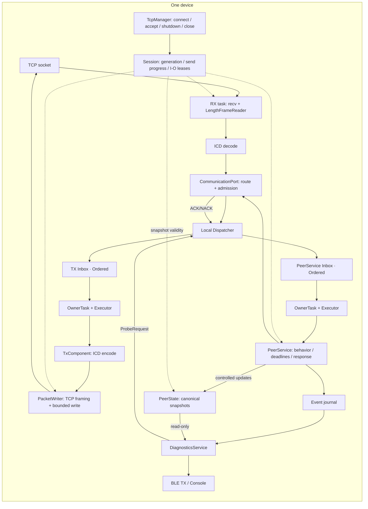
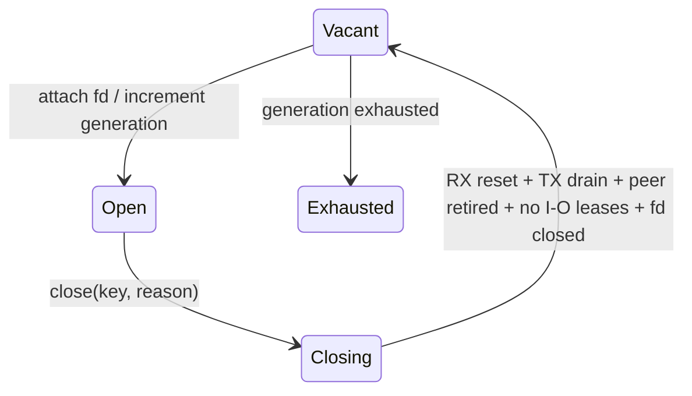

# Raven Communication Architecture

Technical description of the concrete inter-device communication implementation.
General roles, mandatory contracts, and invariants are defined in the
[Raven architectural specification](architecture.md). Describing the code's structure
does not by itself establish compliance with that specification.

## Boundaries

| Layer | Purpose |
|---|---|
| `raven_core` | Component, Activity/Service role declarations, Inbox, Executor, local Dispatcher; no ICD, TCP, or ESP-IDF |
| `raven_icd` | Typed device language and binary codec; no sockets or RTOS |
| `raven_comms` | Session/ReplyRoute, local admission boundary, TX component, length framing |
| `raven_services` | Peer/Diagnostics services, independent PeerState, and shared peer command/result contracts |
| `raven_diagnostics` | Bounded journal and SDK log assembly; no I/O |
| `raven_platform` | OwnerTask, TCP RX/manager/channel, Wi-Fi, monotonic clock |
| `raven_ble` | GATT transport and MC's service text console |
| `raven_app` | Composition, lifetimes, resources, local endpoint IDs, and identity |

`Activity` and `Service` are empty semantic bases over `Component`. They declare
which architectural role contract applies, without adding fields, tasks, or runtime
dispatch behavior. PeerService and DiagnosticsService inherit Service. TCP TX and
BLE TX are adapters and remain Components; there is no concrete Activity in this composition.
Executor and OwnerTask continue to host any Component.

Composition constructs PeerState separately. PeerService receives its mutable write
contract; DiagnosticsService and metrics readers use snapshots without a PeerService
reference. The store owns the peer records' synchronization, immutable local descriptor,
and stale counter. Pending exchanges and deadlines remain with PeerService.
PeerState reads only session validity; it performs no I/O, dispatch, or policy work.

Manual probes use the shared ProbeRequest/ProbeResult payloads and Dispatcher routes
configured by composition. DiagnosticsService does not call PeerService or post to
its Inbox directly. The rationale and preserved contracts are in
[ADR-004](adr/0004-explicit-roles-and-peer-state.md).

RX never waits for service execution. `Dispatcher.deliver()` returns an admission result
synchronously; PeerService executes the accepted message in its OwnerTask. ACK and semantic
response may arrive in either order. A socket has one writer; its RX and TX operate independently.

`CommunicationPort` adapts a specific ICD to local messages. It does not add a queue or make
Dispatcher remote. Composition assigns the peer/diagnostics endpoint binding.
`PacketWriter` receives an already encoded packet: TCP adds a length, while a future UART may
choose its own framing, CRC, and read mechanism. UART will still require platform RX/writer
implementations and logical session open/close rules; a working UART is not claimed here.

## Inbox and execution

The Inbox model is preserved: eight FIFO entries and eight subscriptions. `Ordered` preserves messages;
`Latest` and `Critical` use separate reserved coalescing slots per ID. Critical has safety-critical
meaning and replaces the previous value of the same contract. ACK/NACK, diagnostics, and handshake
do not use Critical. `Critical Ordered` was not added: the current ICD has no event requiring both
critical priority and retention of every individual record.

Executor handles a bounded critical batch, a due tick, then a critical or one ordinary message.
Incoming messages cannot indefinitely displace ticks. The period follows a monotonic schedule;
missed intervals are not replayed in a burst. OwnerTask limits continuous draining to eight steps
before yielding CPU. Each owner's handlers are sequential. A bounded TCP write may take up to
100 ms; that is the platform writer's budget, not a universal service-operation deadline.

## Session and generations

`ReplyRoute = {slot, generation}` is a local reference to a current connection, not a wire address
or Device ID. Generation increases monotonically when a slot is reused. If the counter is exhausted,
the slot becomes Exhausted; wrapping into an old generation is forbidden.

Closure immediately prohibits new admission and new I/O leases. Manager calls `shutdown`, waits for
active calls to finish, the RX parser to reset, and PeerService to retire, then closes the fd with
abortive linger. Old unacknowledged TCP data does not retain closed-connection resources. Partial
frames are not carried over, and queues are not replayed into a new connection.
RX distinguishes retryable recv errors (EAGAIN/EWOULDBLOCK/EINTR) from fatal errors
and EOF. Fatal errors and EOF close the affected generation through Session;
retryable reads still enforce the absolute partial-frame deadline.

Generation validation and the current Peer State commit occur under the same Session::Guard,
with PeerState::Write already held. Lock order is PeerState → Session → Inbox; no I/O occurs under
the Session lock. This protects
current identity/readiness as well as old responses. Stale queued RX is discarded; old TX, late
finish/close, and old send tokens cannot modify a new session. Closure is observable state and
cannot be lost because an event queue is full.

Two bounded SendRecord entries per session support the service's own keepalive/handshake and manual
`ping`. They observe local transmission; they are not a new TransactionManager. Semantic retries
and deadlines belong to PeerService. Another executor may define different contracts and deadlines.

## Identity and scaling

Device ID is a 48-bit factory MAC in a 64-bit field; Boot ID is a random 64-bit value generated at
startup after radio initialization. Hello carries role/capabilities/readiness. Connections are not
bound to COM ports or MAC lists. A bound identity does not change within a session; a second active
peer with the same Device ID is rejected without takeover. The registry holds `2 × capacity`
records; only offline records may be evicted.

The physical board count is not embedded in the architecture. The current MC profile allocates six
RX/TX task pairs, six TX Inboxes, one PeerService, and one journal. Changing capacity means configuring
and verifying resources, not adding a class for each board. Build-specific limits (AP, sockets,
16 local endpoint IDs) are explicit. Dozens of connections may require different task placement or
transport; this document does not promise they fit on the same ESP32-S3 with the same RAM and Wi-Fi limits.

## Current implementation boundaries

Readiness updates currently reach PeerState and the diagnostic journal; a declared
subscriber fan-out is not yet wired. This remains an implementation gap against
SVC-03/DEL-01, not an alternative event contract. The proposed correction reuses
composition-selected destination masks and Dispatcher admission reports.

Runtime lifetime is currently static. Owners, RX loops, the connection manager,
and radio callbacks have no coordinated runtime stop/join path. Session retirement
does not satisfy ROOT-07. This historical gap requires a separately scoped lifecycle
correction; the current review fixes do not implement runtime shutdown.
