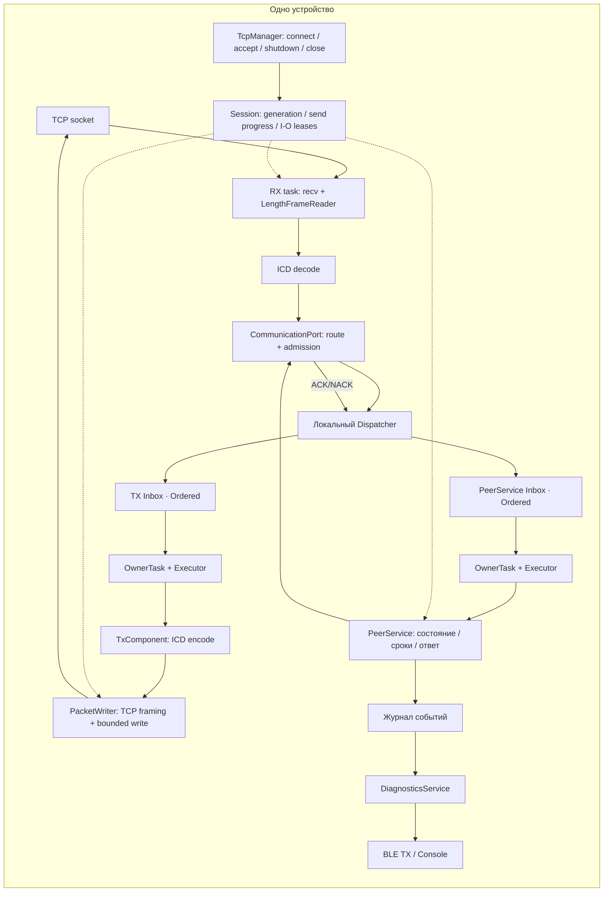
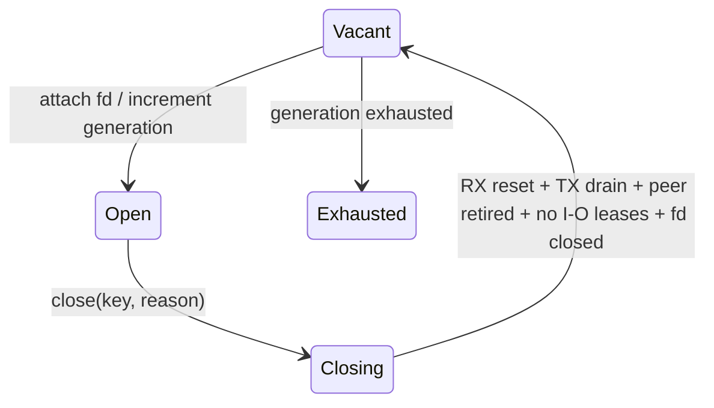

# Архитектура коммуникации Raven

Техническое описание конкретной реализации межустройственного обмена.
Общие роли, обязательные контракты и инварианты определены в
[архитектурной спецификации Raven](architecture.md). Описание устройства кода
само по себе не подтверждает его соответствие этой спецификации.

## Границы

| Слой | Назначение |
|---|---|
| `raven_core` | Component, Inbox, Executor, локальный Dispatcher; без ICD, TCP и ESP-IDF |
| `raven_icd` | Типизированный язык устройств и бинарный codec; без сокетов и RTOS |
| `raven_comms` | Session/ReplyRoute, граница локального admission, TX-компонента, length framing |
| `raven_services` | PeerService: handshake, готовность, keepalive, сроки; DiagnosticsService: запросы и события |
| `raven_diagnostics` | Ограниченный журнал и сборка SDK-логов; без I/O |
| `raven_platform` | OwnerTask, TCP RX/manager/channel, Wi-Fi, монотонные часы |
| `raven_ble` | GATT transport и сервисная текстовая консоль MC |
| `raven_app` | Композиция, lifetime, ресурсы, локальные endpoint IDs и identity |

RX никогда не ожидает исполнения сервиса. `Dispatcher.deliver()` синхронно возвращает результат
admission; PeerService исполняет принятое сообщение в своём OwnerTask. ACK и семантический ответ
могут прийти в любом порядке. Сокет имеет одного writer; его RX и TX работают независимо.

`CommunicationPort` — адаптер конкретного ICD к локальным сообщениям. Он не добавляет очередь и
не делает Dispatcher удалённым. Привязка peer/diagnostics endpoint задаётся при композиции.
`PacketWriter` получает уже закодированный пакет: TCP добавляет длину, будущий UART может выбрать
свой framing, CRC и способ чтения. Для UART всё равно понадобятся платформенный RX/writer и правила
открытия/закрытия логической сессии; готовый UART здесь не заявляется.

## Inbox и исполнение

Модель Inbox сохранена: восемь FIFO-элементов и восемь подписок. `Ordered` сохраняет сообщения,
`Latest` и `Critical` используют отдельные зарезервированные coalescing-слоты по ID. Critical имеет
safety-critical смысл и заменяет предыдущее значение того же контракта. ACK/NACK, диагностика и
handshake не используют Critical. `Critical Ordered` не добавлен: у текущего ICD нет события,
требующего одновременно critical-приоритета и сохранения каждой отдельной записи.

Executor обрабатывает ограниченную critical-порцию, due tick, затем critical либо одно обычное
сообщение. Поступление сообщений не вытесняет tick бесконечно. Период привязан к монотонной сетке;
пропущенные интервалы не проигрываются пачкой. OwnerTask ограничивает непрерывный drain восемью
шагами и отдаёт CPU. Обработчики конкретного владельца последовательны. Ограниченный TCP write
может занять до 100 ms; это бюджет платформенного writer, а не универсальный срок операции сервиса.

## Session и поколения

`ReplyRoute = {slot, generation}` — локальная ссылка на текущее подключение, не wire-адрес и не ID
устройства. Generation монотонно растёт при переиспользовании слота. При исчерпании счётчика слот
становится Exhausted; wrap в старое поколение запрещён.

Закрытие немедленно запрещает новый admission и новые I/O leases. Manager делает `shutdown`, ждёт
завершения активных вызовов, сброса RX parser и retire от PeerService, затем закрывает fd с abortive
linger. Старые неподтверждённые TCP-данные не удерживают ресурсы закрытого соединения. Незавершённые
кадры не переносятся, очереди не replay-ятся в новое подключение.

Проверка поколения и commit актуального Peer State выполняются под одним Session::Guard.
Порядок блокировок: Peer State → Session → Inbox; I/O под Session lock нет. Это защищает не только
старые ответы, но и актуальные identity/readiness. Старые queued RX отбрасываются; old TX, поздний
finish/close и старые send tokens не могут изменить новую сессию. Закрытие — наблюдаемое состояние,
его нельзя потерять из-за заполненной очереди событий.

Два bounded SendRecord на сессию нужны для собственного keepalive/handshake и ручного `ping`.
Это наблюдение за локальной отправкой, не новый TransactionManager. Семантические retries и
deadlines принадлежат PeerService. Другой исполнитель вправе иметь другой контракт и сроки.

## Идентичность и масштабирование

Device ID — 48-bit factory MAC в 64-bit поле; Boot ID — случайные 64 bit при старте после инициализации
радио. Role/capabilities/readiness передаются в Hello. Подключения не привязаны к COM-портам и спискам
MAC. Уже связанная identity не меняется внутри сессии; второй активный peer с тем же Device ID
отклоняется без takeover. Реестр хранит `2 × capacity` записей, вытеснять можно только offline-записи.

Число физических плат не зашито в архитектуру. Текущий MC-профиль выделяет шесть пар RX/TX задач,
шесть TX Inbox, один PeerService и один журнал. Изменение ёмкости — конфигурация и проверка ресурсов,
а не новый класс на каждую плату. Пределы конкретной сборки (AP, сокеты, 16 локальных endpoint IDs)
явные. Десятки соединений могут потребовать другого размещения задач и транспорта; обещания вместить
их в тот же ESP32-S3 с теми же RAM и Wi-Fi ограничениями здесь нет.
