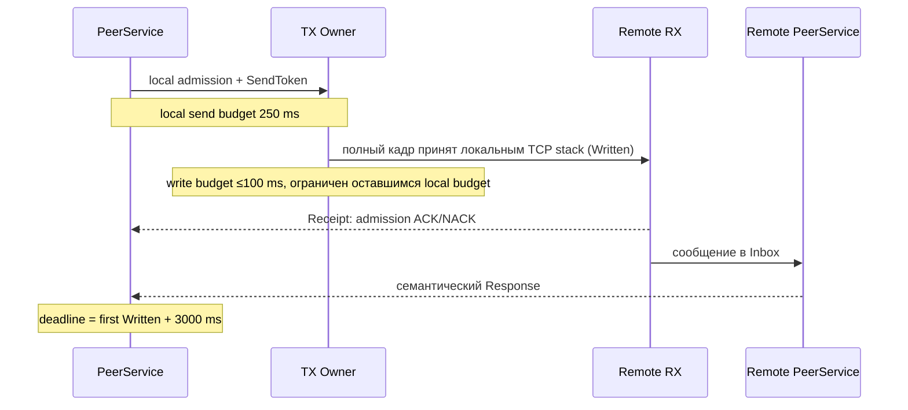

# Device ICD v1 и TCP-профиль

ICD описывает устройства и сообщения; он не сериализует `runtime::Message`, C++ layout или локальные
endpoint IDs. `device_protocol.cpp` выполняет явное big-endian encode/decode без pointer casts на wire.
Внутренние сообщения содержат скопированный Body и локальный route. Заимствованных RX-буферов в Inbox нет.

## Wire

В TCP перед каждым пакетом находится `uint16_be length` без учёта самих двух байт. Приёмник допускает
любую фрагментацию и несколько кадров в одном recv. Length 0 или >64, неверный codec, версия/тип/флаги
закрывают только соответствующую сессию. Незавершённый кадр имеет абсолютный срок 1000 ms от первого
байта; очередной байт срок не продлевает. После ошибки parser остаётся poisoned до reset.

| Заголовок ICD | Bytes | Значение |
|---|---:|---|
| version | 1 | 1 |
| flags | 1 | bit 0: requires admission receipt; остальные 0 |
| type | 2 | Тип сообщения |
| exchange | 4 | Ненулевой correlation ID; у Diagnostic допускается 0 |

| Type | ID | Body bytes | ACK-политика текущих исходящих контрактов |
|---|---:|---:|---|
| HelloRequest | 1 | 48 | requires_ack |
| HelloResponse | 2 | 48 | без ACK |
| KeepAliveRequest | 3 | 20 | без ACK; ожидается семантический ответ |
| KeepAliveResponse | 4 | 20 | без ACK |
| Receipt | 5 | 4 | без ACK |
| Diagnostic | 6 | 16 + text_size, до 48 | best effort, без ACK |

RX также понимает requires_ack на входящем KeepAliveRequest. Внутренний TX-контракт задаёт flag по
типу, а не переносит произвольные wire-флаги через ядро. Нельзя ставить requires_ack на ответ/Receipt.
Максимальный текущий пакет — 56 bytes, с TCP length — 58. Лимит codec 64 оставляет небольшой запас;
изменение контрактов требует пересмотра размеров и `static_assert`, а не молчаливого усечения.

Hello body последовательно содержит:

```text
device_id:u64, boot_id:u64, capabilities:u16,
protocol:u8, role:u8, readiness:u8, reserved_flags:u8, reason:u16,
name:16 bytes, uptime_ms:u64
```

Device/Boot ID не нулевые. Role: 1 MC, 2 Node. Readiness: 0 NotReady, 1 Ready, 2 Rejected.
Name — фиксированное поле, wire не требует завершающего NUL. Capabilities bit 0 — текущий peer exchange.
Reserved flags обязаны быть нулём. Для Hello протокольная версия также доступна внутри descriptor.

KeepAlive body: `origin_ms:u64, uptime_ms:u64, reason:u16, readiness:u8, reserved:u8`.
Ответ возвращает origin запроса и собственный uptime. Эти часы монотонные и локальные;
сравнивать uptime двух плат как синхронизированное время нельзя. TimeSync не реализован.

Receipt: `request_type:u16, admission:u8, reserved:u8` с тем же exchange ID.
Admission: Accepted=0, Full=1, Invalid=2, Unknown=3. Ответ описывает локальный dispatch получателя,
а не готовность peer, результат операции или фактическую отправку ответа.

Diagnostic: `source_ms:u64, sequence:u32, code:u16, severity:u8, text_size:u8, text:0..32 bytes`.
Identity берётся из установленной session binding. У события сохраняются source timestamp и local
receive timestamp. Это ограниченное уведомление; полный удалённый журнал данным ICD не выгружается.

## Время и исходы



Receipt и Response проходят через TX/Dispatcher обеих сторон; на диаграмме обратный путь сокращён.
Порядок прихода ACK и Response не гарантируется. Валидный Response может завершить обмен даже раньше,
чем локальный writer опубликует Written. Он коррелируется по route, generation, exchange и типу.

- Admission в локальный TX не означает Written. Отсчёт 250 ms начинается при reserve непосредственно
  перед попыткой admission. Отказ dispatch немедленно завершает эту попытку локальным отказом.
- Written означает принятие **всего** кадра TCP stack. Это не подтверждение удалённого recv или исполнения.
- Ответ должен быть обработан владельцем до semantic deadline; очередь входит в этот бюджет.
- Hello повторяется после 1 и 2 секунд от первого Written с тем же exchange, максимум три отправки.
  ACK и последующие Written не сдвигают общий deadline. Повторная отправка имеет отдельный local budget.
- KeepAlive: следующий запрос через 1 секунду после успешного ответа; срок ответа 3 секунды.
  Успешные циклы не создают событий. Пассивный node закрывает сессию без Hello спустя 5 секунд.
- RemoteNack, LocalRejected, SendDeadline, TransportLost и ResponseTimeout различаются. Timeout
  никогда не синтезирует «полученный NACK».

Hello/KeepAlive идемпотентны по предметной логике: повторный Hello сохраняет binding и возвращает
готовность, повторный KeepAlive возвращает свежий статус. Завершённый exchange не открывается повторно.
Exactly-once журнал операций и универсальный dedup cache не добавлены; их потребует иной контракт.

## Перегрузка и восстановление

Все текущие outbound сообщения используют Ordered. Diagnostic дополнительно допускает не более
одного pending сообщения на сессию и ограничивается источником до четырёх событий в секунду.
Отказ исходящего optional admission учитывается в счётчике; потеря обязательного ACK/Response закрывает сессию.
Если команда принята, а ACK уже не помещается в TX, соединение закрывается явно: невозможно обещать
получение подтверждения без доступного исходящего канала.

Отправка без Open route отклоняется, в disconnected queue данные не копятся. Новое подключение
начинает новый handshake. TcpManager узла использует DHCP gateway и backoff
250/500/1000/2000/5000 ms + jitter 0..100 ms; после потери живой сессии также есть задержка.
Сокет после partial write обязательно закрывается; хвост кадра никогда не продолжится в другой сессии.

TCP memory profile использует send/window 2880, MSS 1440, выключенный out-of-order queue и
L2→L3 copy. Копирование освобождает общий Wi-Fi RX buffer до ожидания потребителя сокета.
`communication_profile.cmake` задаёт lwIP queue/write thresholds; единственный writer проверяет
`select()` перед каждым коротким кадром. Обоснование и реальные замеры — в [validation.md](validation.md).
