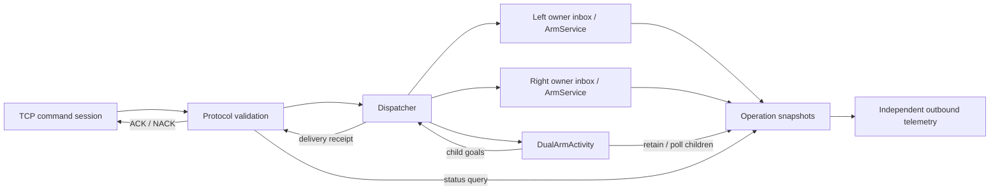

# Raven RND execution prototype

This branch runs two virtual arm services on ESP32-S3. No actuator GPIO/UART is
driven. iOS source is unchanged. The default firmware starts the prototype;
disable `RAVEN_RND_RUNTIME` to boot the previous optional FC integration.



## Owners and execution

`raven_runtime` contains the fixed-storage inbox, dispatcher and deterministic
executor. `raven_rnd` provides `ArmService`, `DualArmActivity`, simulated drivers,
thread-safe operation state and the boundary codec. `raven_rnd_esp` composes them
with FreeRTOS, Wi-Fi and sockets; app_main selects the boot mode. These roles are independent of TCP
and are intentionally not expressed as one RTOS task per operation.

Each arm has a 4096-byte stack and priority 5; Activity has 4096 bytes at priority
4. Mock sensors use 3072 bytes at priority 3, command ingress 6144 bytes at priority
3, telemetry 6144 bytes at priority 2, and the system monitor 4096 bytes at priority
1. Boot tests temporarily use a separate 32768-byte stack. Task creation is dynamic
at bootstrap; message storage and execution state are fixed-capacity thereafter.
The legacy/newlib/Wi-Fi/socket implementations may allocate their own memory.

Owner ticks are scheduled every 10 ms (the supplied SDK config uses 100 Hz).
After eight consecutive queued turns the task yields for one RTOS tick. This
prevents sustained ingress from monopolizing CPU. These are prototype scheduling
choices, not a hardware emergency-stop latency guarantee. The simulator moves
at 90 degrees/s and gives each motion distance/speed plus 500 ms to finish.
Only ArmService knows that budget. A stalled or silent driver becomes TimedOut.
Callback-mode completion is correlated by an internal generation; a stale callback
cannot complete a replacement goal. A dropped callback can produce TimedOut.
Before retargeting or stopping, the owner samples motion up to the command's
timestamp. Target updates between ticks therefore preserve the simulator's
90-degree/s rate; any old completion emitted by that sample keeps its old generation.
Inbox posting and driver callbacks here run in task context; an ISR-backed driver
must first bridge its interrupt into task context using the platform's ISR API.

Move goals replace prior operations with Superseded. Continuous control keeps one
operation Running while Target updates replace its target; settling at a target
does not end the session. Cut ends current and older queued goals with Halted.
New goals after the cut can run. Critical commands are not universal safety logic;
each subscriber implements its own semantics.

Pair creates two child Move operations and polls their statuses. It has no child
timeout. Before dispatch it reserves a result handle from each service's state.
Each state has four fixed retention slots independent of the public history;
the handle holds the result until the scenario first reads its terminal outcome.
Activity then remembers that outcome and releases the slot. Cancellation,
replacement, admission failure and destruction also release handles. If both
handles cannot be reserved, Pair becomes Rejected before dispatching children.
This prevents history churn, including churn before the first poll, from stranding
an active scenario. OperationState must outlive its result handles.
One failure marks the parent Failed while the independent sibling can
finish. Partial child admission marks the parent Rejected without rolling back
the delivered child. Requests for all-or-nothing multi-resource ownership are
outside this prototype. Internal child operation IDs start at `0x80000000`.
When cut, Activity also cancels its previously allocated child-ID range: this
covers children dispatched concurrently with the direct cut. The range is scoped
to this single Activity and does not cancel newer external goals or future pairs.

## Wire contract

One command connection is active at a time. A newly accepted connection replaces
the previous one, even when the previous socket remains open. The listener stays
in the command task's select loop; it does not wait for FIN/RST or a receive error.
Replacement resets the connection's parser and does not cancel accepted operations.
`RAVEN_RND_RUNTIME` selects `LWIP_SO_LINGER`; replacing a socket closes it with
zero linger, without waiting for acknowledgements of its pending outbound data.
The loop handles at most one frame before checking the listener again, with a
100-ms select interval, bounded sends and a yield after eight busy turns. The
regression's recovery budget is two seconds from connecting the replacement to
receiving its status response; it also verifies delivery of Cut on that socket.
TCP keepalive (3-second idle, 1-second interval, 3 probes) additionally cleans up
dead sockets when no replacement arrives; reconnection does not depend on probes.
Replies use the active command connection.
Telemetry continues to use a separate outbound connection, matching the existing
iOS workbench topology. The unchanged header is little-endian `u16 message_id`,
`u32 payload_length`, then payload. Command payloads are bounded to 128 bytes;
oversized headers close the session. Headers and payloads may span TCP reads.
All multibyte wire fields are explicitly little-endian; floats are IEEE binary32.

Request IDs must be nonzero, below `0x40000000`, and unique across clients within
one device boot. There is no automatic retry/reconnect replay. Move/Control/Pair
use the request ID as operation ID. Retained operation IDs are deduplicated by
the owner; once evicted, they must not be retried. The prototype retains the current
snapshot plus the last 16 terminal results per owner, in RAM only.

| ID | Request payload (in field order) | Meaning |
|---|---|---|
| `0x1101` | u32 request, u8 arm, f32 target | Finite Move, target -180..180 degrees |
| `0x1102` | u32 request, u8 arm, f32 target | Begin continuous Control |
| `0x1103` | u32 request, u8 arm, u32 operation, f32 target | Latest target for that Control |
| `0x1104` | u32 request, u8 endpoint mask | Critical Cut; bit 0 left, bit 1 right, bit 2 pair |
| `0x1105` | u32 request, u8 endpoint, u32 operation | Poll status; operation 0 means current |
| `0x1106` | u32 request, u8 arm, u8 mode | Configure mock fault/completion mode |
| `0x1107` | u32 request, f32 left, f32 right | Pair scenario |

Arm numbers are 0/1; status endpoint 2 addresses Activity. A Cut including bit 2
expands to all three endpoints so the activity and both arms receive it without
a delayed second broad cut. Cut and Target are signals, not separately tracked
operations. Mock modes: 0 polling, 1 callback, 2 silent, 3 stalled, 4 error.
Targets only move their matching Control operation. A target serviced ahead of
its already queued Control is retained until that Control starts.

Action delivery returns `0x7f01` ACK or `0x7f02` NACK with:
`u32 request, u16 original_message, u8 reason, u8 accepted_mask, u8 rejected_mask`.
Reasons: 0 accepted, 1 unknown subscription/endpoint, 2 full, 3 invalid envelope.
A NACK can be partial: inspect both masks. ACK is constructed synchronously from
delivery, without waiting for the service to handle the command. Domain-invalid
targets can thus be delivered (ACK) and subsequently have Rejected status.

Status queries directly return `0x7f03` (no additional ACK):
`u32 request, u8 endpoint, u32 operation, u8 status, f32 position, f32 target,
u8 continuous, u64 changed_ms` (27 bytes). Status values: 0 Unknown, 1 Running,
2 Succeeded, 3 Superseded, 4 Halted, 5 TimedOut, 6 Failed, 7 Rejected.
`changed_ms` timestamps a transition/target change, not every telemetry sample.

### Legacy iOS boundary

The old `0x1002` StartManual begins two continuous controls; `0x1001` joystick
maps x/y to left/right targets at 90 degrees per normalized unit; `0x1003` Halt
cuts both arms and Activity. Their original 4/12-byte payload shapes are retained.
Their new receipt has request ID 0 because those legacy frames have no correlation
field. New legacy sessions supersede previous control operations. A StartManual
is required before joystick frames; after Cut, Target alone never restarts motion.

Outbound `0x3001` JSON preserves the existing navigation/system/sensors schema
and adds an `arms` array. These are mock values, not FC telemetry. No iOS code or
UI is changed; an actual iOS build/run remains a separate task.

## Run and verify

Use ESP-IDF 6.1.1 with target esp32s3:

```sh
idf.py reconfigure
idf.py build
idf.py -p COM3 flash
python tests/run_board_tests.py --port COM3
```

`RAVEN_RND_SELF_TEST` runs deterministic tests and TCP/slow-telemetry loopback
tests at boot. Look for individual `TEST ... PASS` lines and `RND_SELF_TEST PASS`.
The Python runner resets the development board and then watches for runtime
faults. Disable the boot-test option for manual sessions so its loopback client
does not contend with the external command connection.
The suite currently reports 20 cases, including retained child results, retargets
between ticks, concurrent pair cancellation and command-session replacement;
the final log also reports each worker's minimum free stack in bytes.

Without a station SSID, the board starts development AP `Raven-RND`, password
`raven-rnd`, address `192.168.4.1:8080`. This is a local mock-device workbench,
not an authenticated production control channel. Alternatively configure station
SSID/password under `Raven RND prototype`; keep credentials in ignored sdkconfig.
Set the outbound telemetry IPv4/port there for the existing iOS server. An empty
host disables external telemetry. The firmware never changes the computer's Wi-Fi.

```sh
python tests/tcp_smoke.py --host 192.168.4.1
cmake -S tests/host -B build/host
cmake --build build/host
ctest --test-dir build/host --output-on-failure
```

The same deterministic suite runs on the MCU and host. The host CMake also builds
the original MSP tests on platforms providing POSIX ssize_t. Board loopback tests
exercise actual FreeRTOS scheduling and lwIP; they do not prove an iPhone session
or over-the-air Wi-Fi throughput. Measure those separately when iOS work resumes.
The replacement regression leaves the original socket open (no FIN/RST), including
partial-header and partial-payload cases. It tests session takeover on real lwIP;
it does not simulate radio loss or independently measure keepalive probe expiry.
